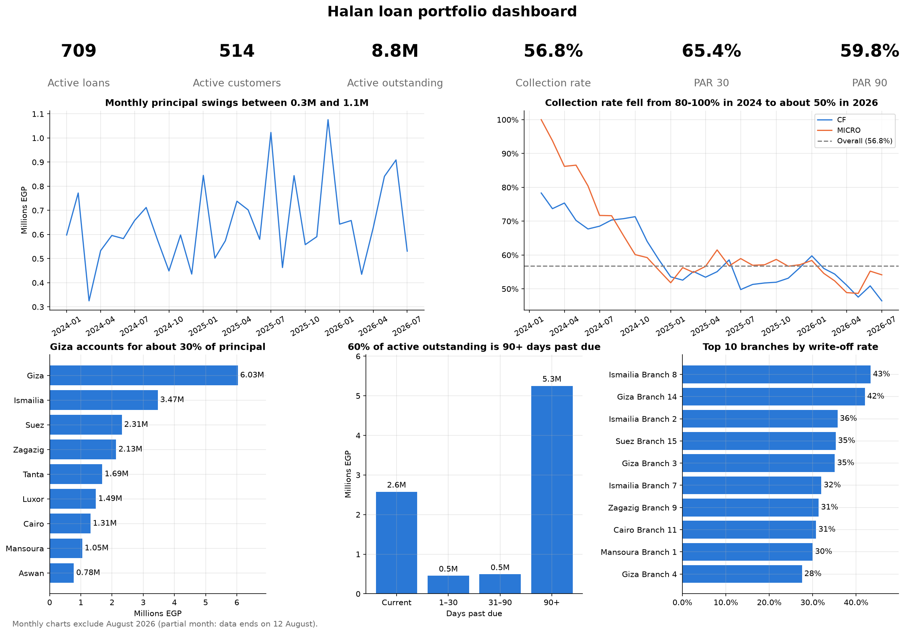

# Lending Portfolio Story Dashboard (Power BI + SQL + Python)

A multi-page Power BI report, a set of PostgreSQL queries and a Python notebook that turn a loan portfolio into a story: who we lend to, who comes back, who leaves, where the risk sits, and what we fail to collect. Built during a data-department internship at MNT-Halan (Cairo, 2026).

> **Demo data.** The dataset is not real: it is demo data provided during the internship. The Power BI report file and the CSVs are intentionally **not** included in this repository. Figures below describe the demo data and are not realistic benchmarks.

---

## 📊 Report Structure & Pages

Every chart section has a headline that states the finding, so the report reads as a story instead of a list of numbers.

| Page | Question Addressed |
| :--- | :--- |
| **Executive summary** | What does the whole portfolio look like at a glance? |
| **Issuance** | How much do we lend, and is the average ticket changing? Who gets the loans? |
| **Churn** | Who borrows, who comes back, who leaves, and how fast do customers return? |
| **Portfolio and risk** | Where does the book sit, how risky is it, and how much is written off? |
| **Collection** | How much of what falls due do we collect, and where do we lose it? |

---

## 📈 Selected Findings (Demo Data)

| Category | Finding / Metric |
| :--- | :--- |
| **Retention** | Only 632 of 1,000 approved customers ever borrowed, and 263 borrowed again. |
| **Churn Rate** | Falls from 28% after one loan to 12% after two and 7% after three or more. 131 customers (20.7% of borrowers) are churned. |
| **Return Time** | Customers take about 309 days to take a 2nd loan, 234 days for a 3rd, and 149 days afterwards. |
| **Issuance Trend** | The average ticket rose from about 17K (Nov 2025) to 27K (Jul 2026), while monthly volume fell from 37 loans in June to 20 in July. |
| **Portfolio Risk** | PAR 90 is 69% for new customers versus 47% for repeat customers. About 26% of principal issued has been written off. |
| **Collection Performance** | 56.8% of what has fallen due is collected. 30K-40K loans collect worst (50%) while 40K-50K loans collect best (64%). |

### Churn Definition
A customer is churned when their last loan finished more than 90 days before the latest issue date in the data, they have no newer loan, and the last loan was not written off. Other statuses include **Active** (a loan still running), **Recently completed** (finished less than 90 days ago), and **Written off**. See `sql/01_loan_flags.sql`.

---

## 🏗️ Data Model

| Component | Description |
| :--- | :--- |
| **Base Tables (CSV)** | `application` (loans), `installment`, `customer`, `branch`, `officers` |
| **SQL Tables** | Per-loan flags (`loan_flags`, one-to-one with `application`) and summary tables (`journey`, `days_between_loans`, `collection_by_month`, `collection_by_loan_term`) |
| **Filtering Logic** | One company filter drives every page. Summary tables carry a `company` column and link to a small company table related to `application`. |

---

## ⚙️ SQL Scripts

Run these scripts on PostgreSQL with the five base tables loaded. *Dates are stored as epoch milliseconds in the source data.*

| File Name | Purpose |
| :--- | :--- |
| `01_loan_flags.sql` | Loan sequence, new vs returning, customer status, churn flag (CTEs and window functions) |
| `02_journey_funnel.sql` | Approved, 1st, 2nd and 3rd loan customers |
| `03_average_days_between_loans.sql` | Average days between consecutive loans |
| `04_collection_by_month.sql` | Expected vs collected by month |
| `05_collection_by_loan_term.sql` | Collection rate by loan term |
| `06_written_off_by_issue_month.sql` | Written-off loans and principal by issuance month |
| `07_principal_last_month.sql` | Principal issued in the last complete month |

---

## 🐍 Python Analysis (pandas + Matplotlib)

The same demo dataset analysed again in Python, from raw CSV files to a one-page dashboard, in a Jupyter notebook: [`python-analysis/loan_dashboard.ipynb`](python-analysis/loan_dashboard.ipynb) (an HTML copy is next to it).



### What the notebook covers

| Part | Content |
| :--- | :--- |
| **1. Load and inspect** | Typed loading (IDs, phones and NIDs kept as text), timestamps to datetimes, value counts, missing values |
| **2. Prepare** | New columns (month, loan total, interest rate, ticket bands) and validated merges (`validate="m:1"`, row counts checked) into one loan table and one installment table |
| **3. Group and aggregate** | `groupby`, named aggregation, `transform`, `filter`, running totals, branch and officer scorecards |
| **4. Pivot and reshape** | `pivot_table`, `crosstab`, `melt`, `stack` / `unstack`, conditional formatting, Excel export (`pivots.xlsx`) |
| **5. Visualise** | Line, bar, grouped and stacked bars, histogram, box plot, scatter, donut, heatmap, small multiples |
| **6. KPIs and dashboard** | KPI table and cards, a reusable `kpis()` function, a days-past-due chart, a one-page dashboard saved as PNG |

### Key definitions

| Term | Definition |
| :--- | :--- |
| **As-of date** | 12 August 2026 (the "today" of the dataset). The last month is partial and is excluded from the monthly charts. |
| **Active loan** | `loan_status == "issued"` and not written off. |
| **Collection rate** | Collected / expected, on installments due on or before the as-of date. |
| **Days past due** | As-of date minus the due date of the loan's oldest due installment that is not fully paid. |
| **PAR 30 / PAR 90** | Outstanding principal of active loans more than 30 / 90 days past due, divided by total active outstanding. |

### Python results (demo data)

| Metric | Result |
| :--- | :--- |
| **Collection rate** | 56.8% of what has fallen due is collected (MICRO 57.8%, CF 55.7%), the same figure as in the Power BI report. |
| **PAR 30 / PAR 90** | 65.4% and 59.8% of active outstanding. These are high because a late loan counts with its whole remaining balance. |
| **Geography** | Giza accounts for about 30% of principal issued. |

### Running the notebook

```bash
pip install -r python-analysis/requirements.txt
jupyter lab
```

Tested with Python 3.13. The notebook expects the five CSV files (`application.csv`, `branch.csv`, `customer.csv`, `installment.csv`, `officers.csv`) in a `data/` folder next to it, then **Kernel > Restart Kernel and Run All Cells**. The CSV files are not included in this repository.

---

## ⚠️ Limits & Caveats

| Limitation | Detail |
| :--- | :--- |
| **Hard-coded Dates** | The "as of" date (11 August 2026) is hard-coded in some queries and measures. Update it when refreshing data. |
| **Two As-of Dates** | The Python notebook uses 12 August 2026, while the Power BI report and SQL scripts use 11 August 2026. The collection rate (56.8%) is the same in both. |
| **Sample Size** | Branch-level rates rest on small samples (about 19 to 41 customers per branch), so treat them as a directional signal. |
| **Synthetic Metrics** | Metrics such as PAR 90 (about 60%) are unrealistic for a real lender because the data is synthetic. |
| **Notebook Outputs** | The notebook shows a few sample rows of the demo data (fake names, phone numbers and national IDs). The full CSV files are not included. |

---

## 🛠️ Tools & Tech Stack

* **PostgreSQL:** CTEs, window functions, data aggregation
* **Power BI:** Data modelling, interactive multi-page dashboards
* **Python:** pandas, Matplotlib, Jupyter (analysis notebook and dashboard)
* **Methodology:** Data storytelling, executive-ready presentation

---

## 👤 Author

* **Youssef Kandil** — Computer Science Student at Université Paris Cité
